<a href="https://www.m1d0.com"><picture><source media="(max-width: 640px)" srcset="./assets/banner-mobile.svg" /></picture></a>

<a href="https://github.com/M1D0-Technologies/dahhan-enterprises">Dahhan Enterprises</a> · <a href="https://github.com/M1D0-Technologies/dahhan-industries">Dahhan Industries</a> · <a href="https://github.com/M1D0-Technologies/miss-dantella">Miss Dantella</a> · <b>M1D0 Technologies</b> · <a href="https://github.com/M1D0-Technologies/platform-engineering">Platform Engineering</a> · <a href="https://github.com/M1D0-Technologies">Organization</a>

# M1D0 Technologies

M1D0 Technologies is a founder-led boutique business and digital transformation firm working across business strategy, operations and technology through long-term partnerships.

## How M1D0 works

<picture><source media="(prefers-color-scheme: dark) and (max-width: 640px)" srcset="./assets/how-mobile-dark.svg" /><source media="(max-width: 640px)" srcset="./assets/how-mobile-light.svg" /><source media="(prefers-color-scheme: dark)" srcset="./assets/how-dark.svg" /></picture>

Work begins with understanding the business itself—its purpose and values, what it offers, whom it serves and how it operates—before determining what to optimize and modernize. From that understanding, M1D0 sets the direction for business transformation, aligning expertise and resources to strengthen operations, decision-making, customer relationships and the capacity to adapt and grow.

Technology follows that direction, with systems and capabilities selected to support the business's priorities and redesigned operations—connecting people, processes, systems and information rather than dictating how the business works. AI and automation are introduced only where they serve a clear business purpose—not as goals in themselves.

<picture><source media="(prefers-color-scheme: dark) and (max-width: 640px)" srcset="./assets/founder-mobile-dark.svg" /><source media="(max-width: 640px)" srcset="./assets/founder-mobile-light.svg" /><source media="(prefers-color-scheme: dark)" srcset="./assets/founder-dark.svg" /></picture>

Direct founder involvement maintains strategic direction, quality and accountability from planning through implementation, integration and adoption. Specialist expertise is coordinated under that direction, informed by firsthand experience of the commercial decisions and operational realities of running businesses. As priorities evolve, M1D0 remains involved in refining strategy, strengthening operations and developing the capabilities needed to pursue opportunities and grow with greater control.

## Specialties

<picture><source media="(prefers-color-scheme: dark) and (max-width: 640px)" srcset="./assets/specialties-mobile-dark.svg" /><source media="(max-width: 640px)" srcset="./assets/specialties-mobile-light.svg" /><source media="(prefers-color-scheme: dark)" srcset="./assets/specialties-dark.svg" /></picture>

## Connected through Dahhan Enterprises

As one of the businesses connected through Dahhan Enterprises, M1D0 leads the transformation and long-term development of Dahhan Industries and Miss Dantella—across operations, commerce and supporting systems.

<picture><source media="(prefers-color-scheme: dark) and (max-width: 640px)" srcset="./assets/businesses-mobile-dark.svg" /><source media="(max-width: 640px)" srcset="./assets/businesses-mobile-light.svg" /><source media="(prefers-color-scheme: dark)" srcset="./assets/businesses-dark.svg" /></picture>

## The measure of progress

<picture><source media="(prefers-color-scheme: dark) and (max-width: 640px)" srcset="./assets/progress-mobile-dark.svg" /><source media="(max-width: 640px)" srcset="./assets/progress-mobile-light.svg" /><source media="(prefers-color-scheme: dark)" srcset="./assets/progress-dark.svg" /></picture>

Progress is measured by the strength of the business itself: clearer ownership, stronger internal capabilities and dependable operations that evolve with its needs. M1D0 is selective in its partnerships, working with businesses that value sound judgment, decisive action, shared accountability and sustained development.

## Links

<a href="https://www.m1d0.com"><picture><source media="(prefers-color-scheme: dark) and (max-width: 640px)" srcset="./assets/tiles/web-mob-dark.svg" /><source media="(max-width: 640px)" srcset="./assets/tiles/web-mob-light.svg" /><source media="(prefers-color-scheme: dark)" srcset="./assets/tiles/web-desk-dark.svg" /></picture></a><a href="https://www.linkedin.com/company/m1d0/"><picture><source media="(prefers-color-scheme: dark) and (max-width: 640px)" srcset="./assets/tiles/li-mob-dark.svg" /><source media="(max-width: 640px)" srcset="./assets/tiles/li-mob-light.svg" /><source media="(prefers-color-scheme: dark)" srcset="./assets/tiles/li-desk-dark.svg" /></picture></a>

Documentation and showcase material only; product source code is kept private. © 2026 Dahhan Enterprises LLC. All rights reserved.
